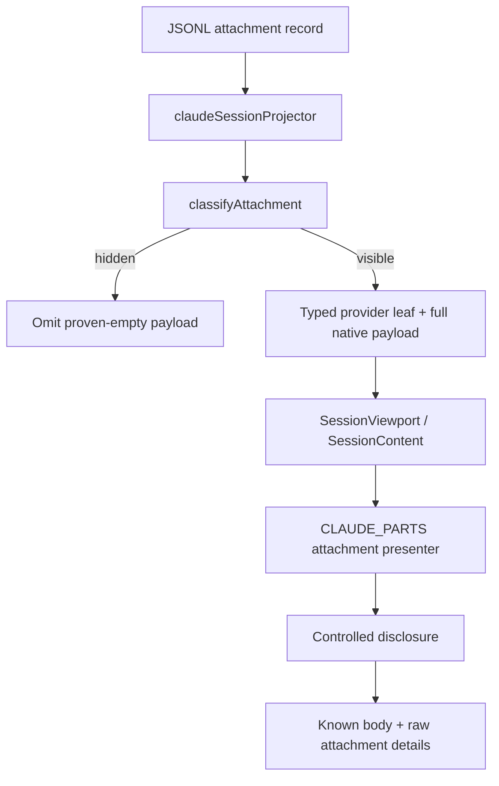

# Attachment Rendering

Claude Code writes JSONL records whose `type` is `attachment`; each payload has its own `attachment.type` discriminator. The expanded transcript keeps the original attachment payload and its classifier result together, then presents them as typed native content. The [classifier](/public/packages/default-configuration/src/streams/claude-code-session/www/lib/classify-attachment.ts#L168) determines visibility, scope, tier, summary, severity, and link metadata; the [Claude projector](/public/packages/default-configuration/src/streams/claude-code-session/www/lib/project-session.ts#L449) assigns stable row and part identities while retaining source provenance.

## Rendering flow

The expanded owner passes a coherent native snapshot to [`ClaudeSourceView()`](/public/packages/default-configuration/src/streams/claude-code-session/www/components/expanded/ExpandedView.tsx#L42-L99). Its projector emits semantic rows; [`SessionViewport`](/public/packages/default-configuration/src/streams/lib/session/SessionViewport.tsx#L57-L72) owns scrolling and anchor behavior, and [`SessionContent()`](/public/packages/default-configuration/src/streams/lib/session/SessionContent.tsx#L78-L81) renders stable rows with controlled disclosure and bounded inspection state. The typed [`CLAUDE_PARTS`](/public/packages/default-configuration/src/streams/claude-code-session/www/components/expanded/ClaudePresentation.tsx#L255-L270) registry selects provider presentation without converting records into vendor conversation messages.

The projector validates attachment collection shapes before calling [`classifyAttachment()`](/public/packages/default-configuration/src/streams/claude-code-session/www/lib/classify-attachment.ts#L168). It omits a row only when the descriptor marks a proven-empty payload hidden; otherwise it stores both the native attachment and descriptor in the provider leaf. Hook records carrying a `toolUseID` join the source-local tool association. Until a result completes the nested presentation, the source hook row remains visible; once paired, the hook details appear with the tool ([projector attachment path](/public/packages/default-configuration/src/streams/claude-code-session/www/lib/project-session.ts#L449-L472)).

The provider [`Attachment()` presenter](/public/packages/default-configuration/src/streams/claude-code-session/www/components/expanded/ClaudePresentation.tsx#L101-L119) uses the descriptor's summary and severity for its [`SessionDisclosure`](/public/packages/default-configuration/src/streams/lib/session/SessionContent.tsx#L316-L350). Its [`AttachmentBody()`](/public/packages/default-configuration/src/streams/claude-code-session/www/components/expanded/ClaudePresentation.tsx#L124-L165) assembles known bodies only after the disclosure opens and always includes a separate raw-details leaf for the complete native payload. The shared [`Body()` presenter](/public/packages/default-configuration/src/streams/claude-code-session/www/components/expanded/ClaudePresentation.tsx#L49-L77) bounds large text before formatting, displays structured JSON as JSON, renders Markdown through the safe shared renderer, and keeps other text pre-wrapped.

## Tool-scoped hooks

The projector attaches hook records with a matching tool id to that tool's retained `hooks` list. The tool presenter then renders the call, result, supplemental content, hook bodies, and raw details under controlled disclosures. A hook with no rendered owner stays as a visible provider row. Hook text is assembled by [`hookBodyText()`](/public/packages/default-configuration/src/streams/claude-code-session/www/components/accordions/HookRow.tsx#L77-L108); JSON-shaped bodies use the shared JSON view, Markdown-shaped bodies use the shared Markdown renderer, and ordinary text remains pre-wrapped.

## Turn-scoped context and content

The descriptor's `tier` keeps ambient context distinct from content disclosures. Consecutive ambient entries are grouped by the native projector as a `Context · N updates` row. Known bodies reuse the same parsing helpers as the attachment summaries while retaining the original payload for inspection.

| Attachment types | Summary or visible body | Hidden only when |
|---|---|---|
| `team_context` | Team and agent identity | Never |
| `command_permissions` | Count of allowed tools | The allowed collection is empty |
| `deferred_tools_delta` | Added and removed tool names | Both deltas are empty |
| `mcp_instructions_delta` | Added MCP instruction names | Never |
| `agent_listing_delta` | Added and removed agent names | Both deltas are empty |
| `task_reminder` | Pending task count and content | The item count is zero |
| `nested_memory`, `skill_listing`, `invoked_skills`, `dynamic_skill` | Memory or skill content | Never |
| `file`, `edited_text_file`, `queued_command` | File text, edit context, or queued prompt | Never |
| `compact_file_reference`, `opened_file_in_ide`, `selected_lines_in_ide` | Referenced path or selected lines | Never |

The content helpers are [`contextBodyText()`](/public/packages/default-configuration/src/streams/claude-code-session/www/components/expanded/messages/attachment/ContextStateRow.tsx#L100-L116), [`disclosureBodyText()`](/public/packages/default-configuration/src/streams/claude-code-session/www/components/expanded/messages/attachment/DisclosureRow.tsx#L46-L62), and [`fileBodyText()`](/public/packages/default-configuration/src/streams/claude-code-session/www/components/expanded/messages/attachment/FileRow.tsx#L104-L131). Their output is formatted by the provider presenter while the complete payload remains available for inspection.

## Session markers and unknown types

`date_change` remains a session-scoped attachment. `away_summary` is a system subtype, not an attachment; the native projector represents it as provider prose in a boundary row ([system-event handling](/public/packages/default-configuration/src/streams/claude-code-session/www/lib/project-session.ts#L567-L618)).

An unknown or future `attachment.type` remains visible. Its classifier summary labels the controlled attachment disclosure, and the raw-details leaf preserves the original payload for bounded inspection. The same rule applies to unknown message records: native projection retains them as raw content, and [`SessionContent()`](/public/packages/default-configuration/src/streams/lib/session/SessionContent.tsx#L507-L519) renders raw content as an explicit disclosure instead of silently dropping it.
